# Figure Catalog — UGYON / SasterGPT

Screenshots are grouped by folder and listed in presentation order. Each entry shows the image and a caption ready for slides.

---

## Entry

### Figure 1 — Login Page

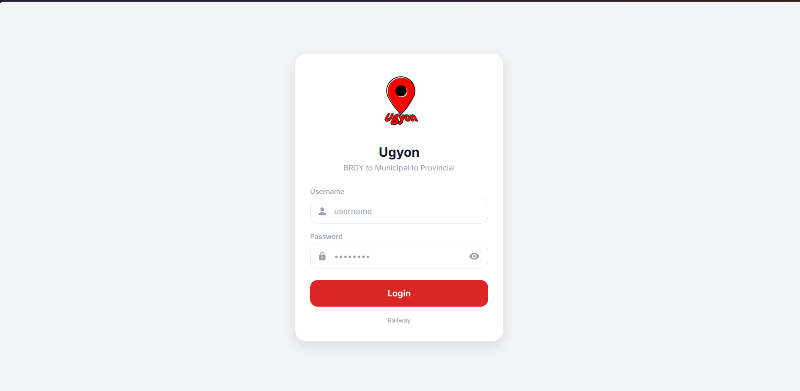

> **Caption:** The login page authenticates every user and routes them to the tier matching their role.

---

## Barangay Tier — BHERT

### Figure 2 — BHERT Dashboard

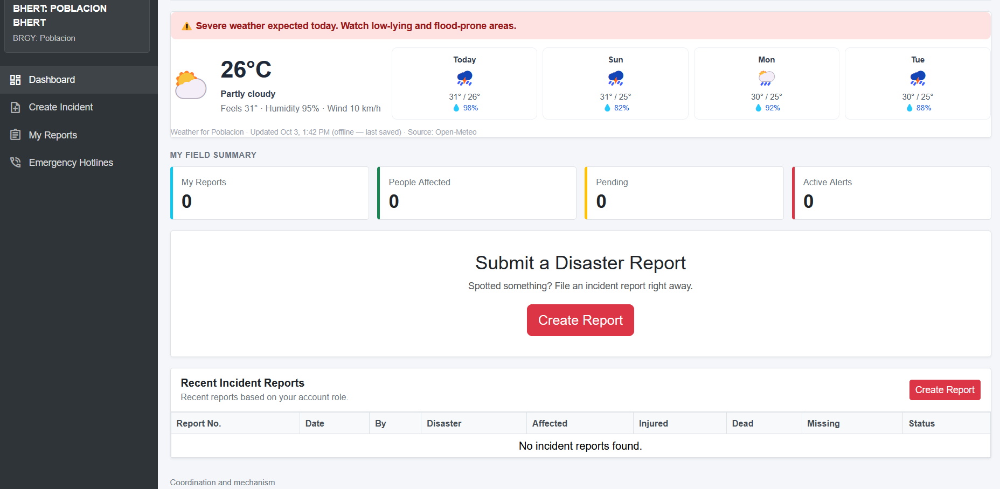

> **Caption:** The BHERT dashboard summarizes incidents and affected population for its own barangay.

### Figure 3 — BHERT Create Incident

> **Caption:** BHERT encodes the incident details, casualties, evacuation status, and road accessibility.

### Figure 4 — BHERT My Reports

> **Caption:** Reports filed by the barangay account are listed with their current status.

### Figure 5 — Incident Detail

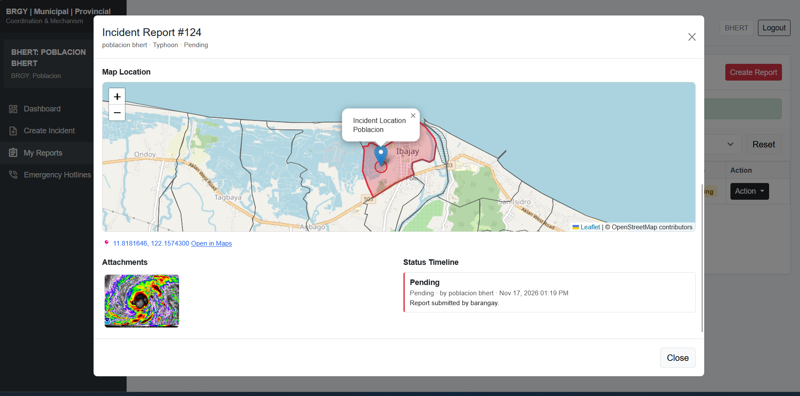

> **Caption:** The incident detail view shows the full report, attachments, and status history.

---

## Barangay Tier — Chairman

### Figure 6 — Chairman Dashboard

> **Caption:** The Chairman dashboard presents barangay-wide incident and evacuation center totals.

### Figure 7 — Report Actions

> **Caption:** A pending report exposes View Details, Edit, Review, and Dismiss actions.

### Figure 8 — Report Reviewed

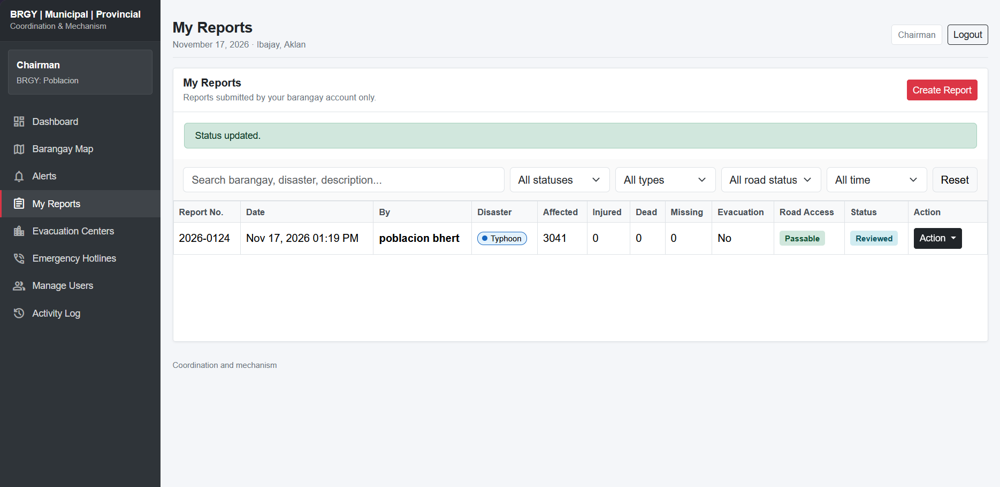

> **Caption:** Reviewing the report changes its status to Reviewed.

### Figure 9 — Forwarded to MDR

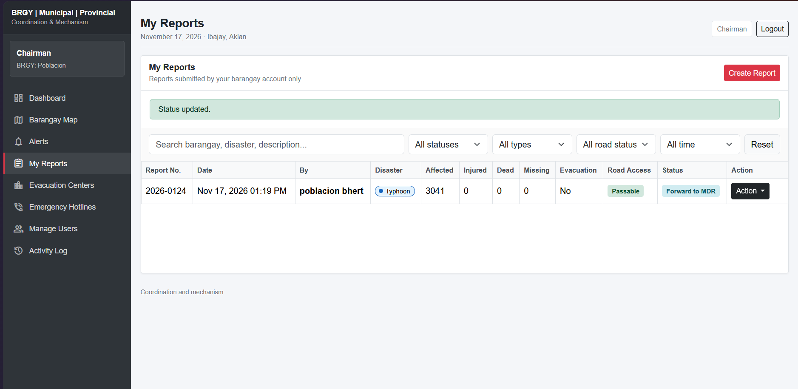

> **Caption:** The reviewed report is forwarded to the Municipal Disaster Risk Reduction and Management office.

### Figure 10 — Activity Log

> **Caption:** The activity log records every action taken on barangay reports.

### Figure 11 — Manage Users

> **Caption:** The Chairman manages the accounts of barangay personnel.

---

## Barangay Tier — Secretary

### Figure 12 — Secretary Dashboard

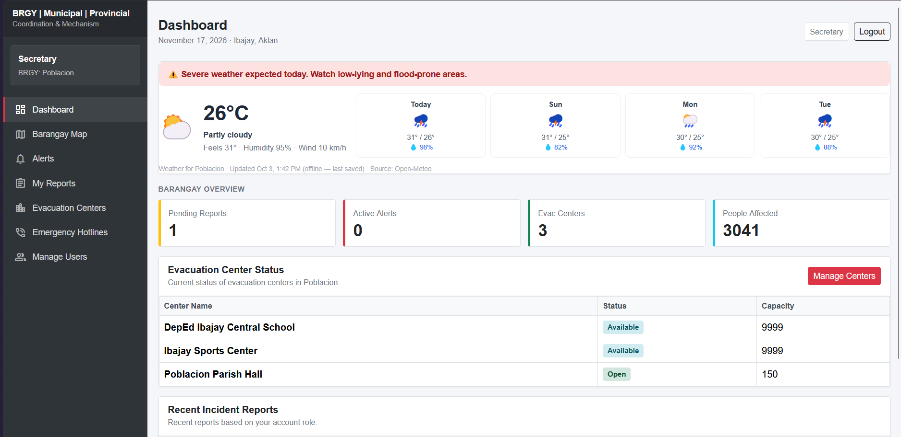

> **Caption:** The Secretary dashboard shows the barangay's centers, occupants, and reports.

### Figure 13 — Evacuation Centers

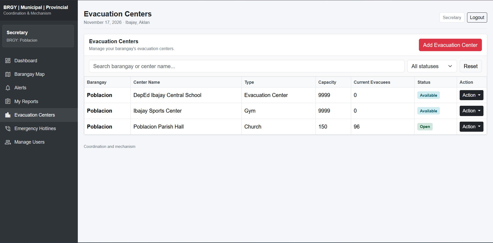

> **Caption:** Evacuation centers are listed with type, capacity, evacuee count, and status.

### Figure 14 — Alerts

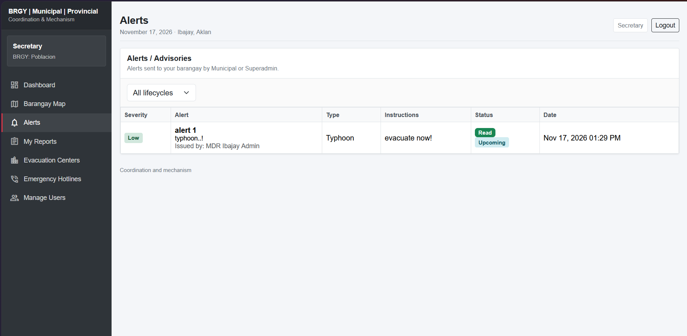

> **Caption:** Alerts from higher offices are displayed to barangay personnel.

### Figure 15 — Barangay Map

> **Caption:** The barangay map plots incidents and evacuation centers within the barangay.

---

## Needs & Assistance

### Figure 16 — Declared Needs and Linked Incidents

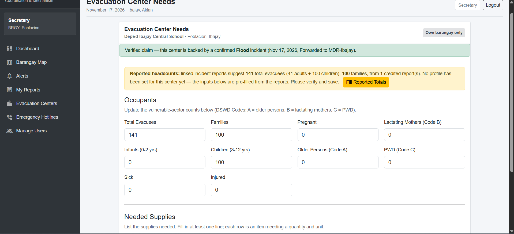

> **Caption:** A center linked to a confirmed incident shows a verified claim banner and reported headcounts.

### Figure 17 — Needs Declared

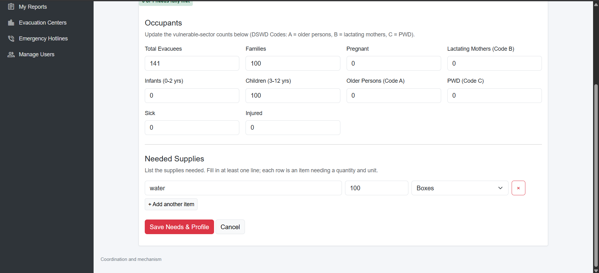

> **Caption:** The Secretary declares occupants and needed supplies by item, quantity, and unit.

### Figure 18 — MDR Pledge

> **Caption:** MDR-Ibajay pledges water, and the need shows the incoming quantity.

### Figure 19 — PDR Pledge

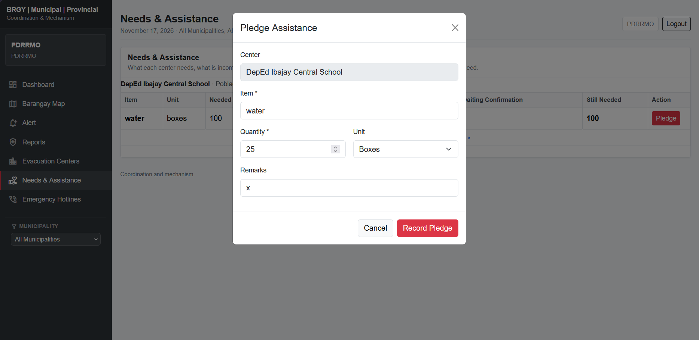

> **Caption:** PDRRMO records its pledge through the pledge assistance form.

### Figure 20 — Pledge Ledger

> **Caption:** The donation ledger lists each pledge with donor, quantity, and status.

### Figure 21 — Pledge Out for Delivery

> **Caption:** Pledges advanced to Sent and Delivered are shown with their timestamps.

### Figure 22 — Confirmed Received

> **Caption:** The barangay confirms the quantity received for a delivered donation.

### Figure 23 — Pledge Fulfilled

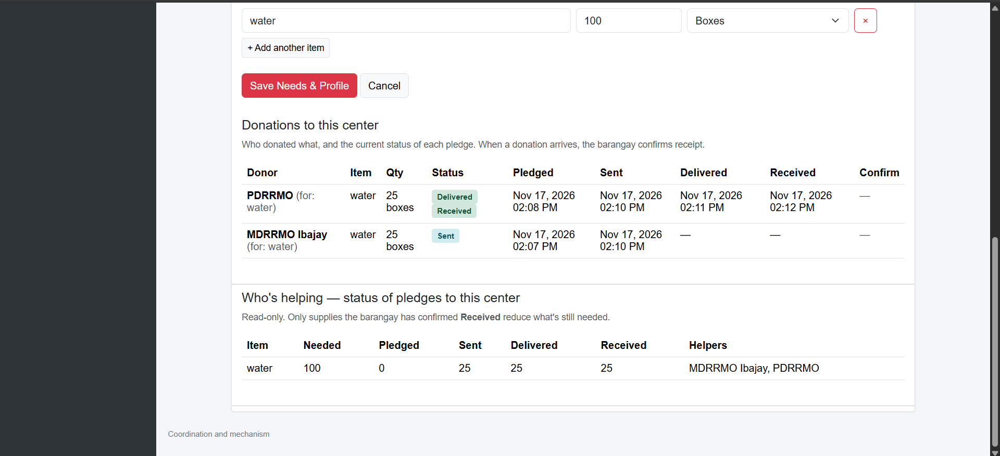

> **Caption:** Received donations are credited toward the declared need in the fulfillment table.

---

## Municipal Tier — MDR Ibajay

### Figure 24 — MDR Dashboard

> **Caption:** The municipal dashboard aggregates reports from all barangays in Ibajay.

### Figure 25 — MDR All Incident Reports

> **Caption:** MDR views every incident report submitted within its municipality.

### Figure 26 — Under MDR Review

> **Caption:** Reports forwarded by barangays arrive under municipal review.

### Figure 27 — Under MDR Review Actions

> **Caption:** The action menu shows the decisions available during municipal review.

### Figure 28 — Verified Report

> **Caption:** A validated report is marked Verified.

### Figure 29 — Responding Report

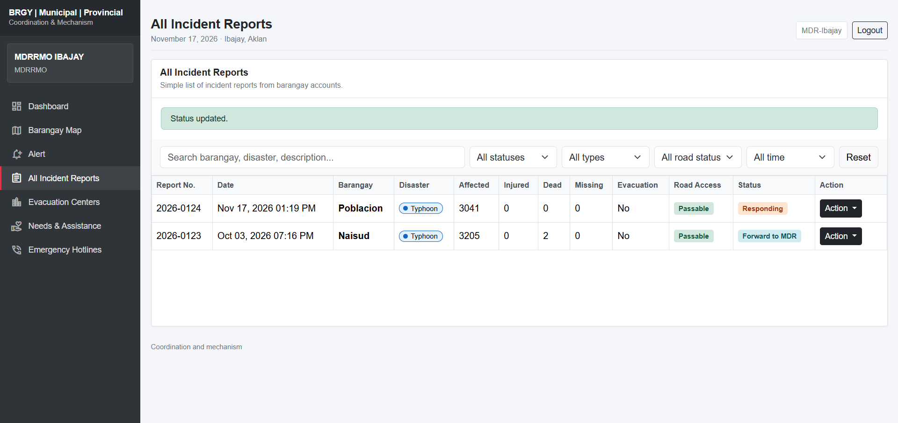

> **Caption:** A verified report moves to Responding once municipal action begins.

### Figure 30 — Referred to Provincial

> **Caption:** Reports beyond municipal capacity are referred to the provincial office.

### Figure 31 — Mayor View

> **Caption:** The Mayor sees municipal incident totals, evacuation center status, and per-barangay urgency.

---

## Provincial Tier — PDRRMO

### Figure 32 — PDRRMO Dashboard

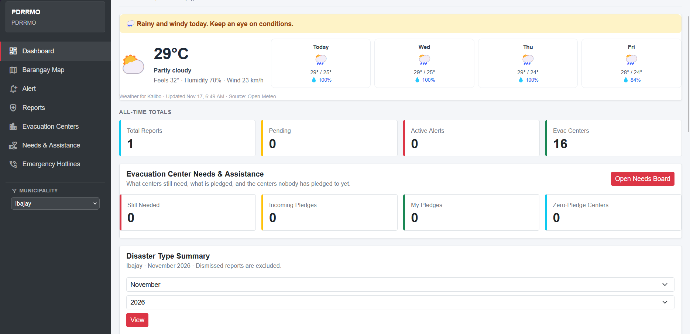

> **Caption:** The provincial dashboard consolidates reports from all municipalities.

### Figure 33 — PDRRMO Referred Reports

> **Caption:** Reports referred by municipalities appear in the provincial queue.

### Figure 34 — Report Under Review

> **Caption:** Provincial staff review referred reports before acting.

### Figure 35 — Report Responding

> **Caption:** Reports marked Responding show where provincial resources are committed.

### Figure 36 — PDRRMO Barangay Map

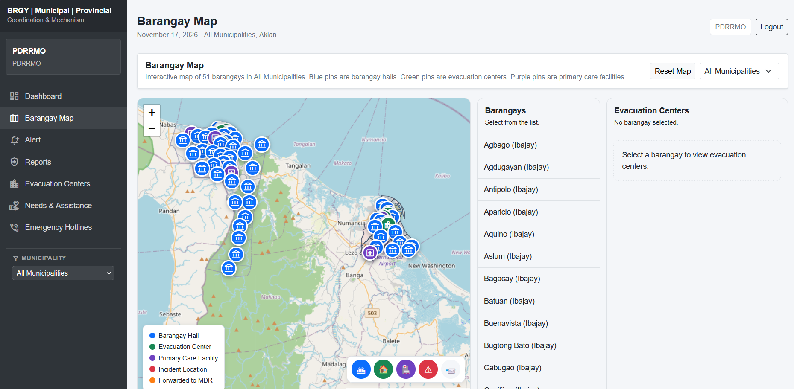

> **Caption:** The provincial map shows incidents and centers across municipalities.

### Figure 37 — Governor View

> **Caption:** The Governor sees Provincial incident totals, evacuation center status, and per-barangay urgency.

### Figure 38 — Governor Dashboard

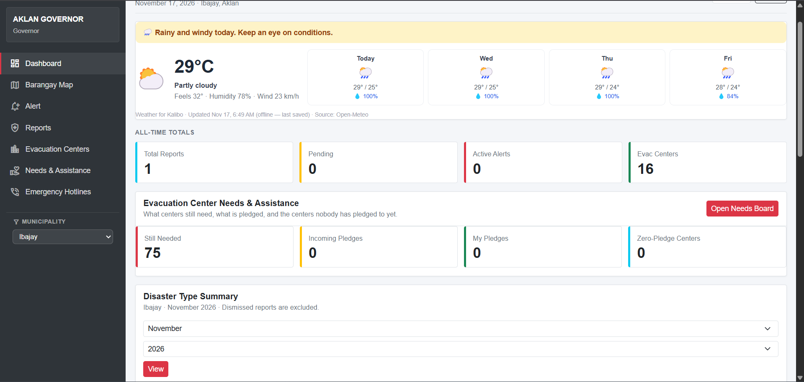

> **Caption:** The Governor sees overview of all incidents in the province, evacuation center status, and per-municipality urgency.

### Figure 39 — Governor Wide Map

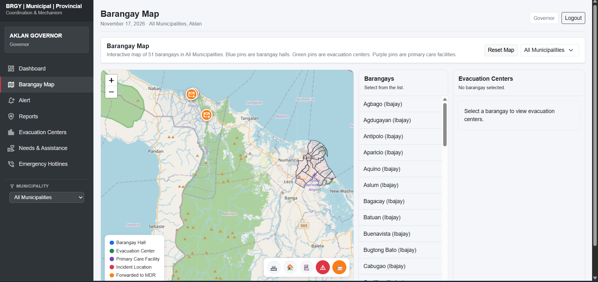

> **Caption:** The Governor sees Provincial incident totals, evacuation center status, and per-barangay urgency.

## Mobile App — BHERT Field Reporting

| App Login | App Dashboard | App Location Pin | App Disaster Types |
|:-:|:-:|:-:|:-:|
|  |  |  | 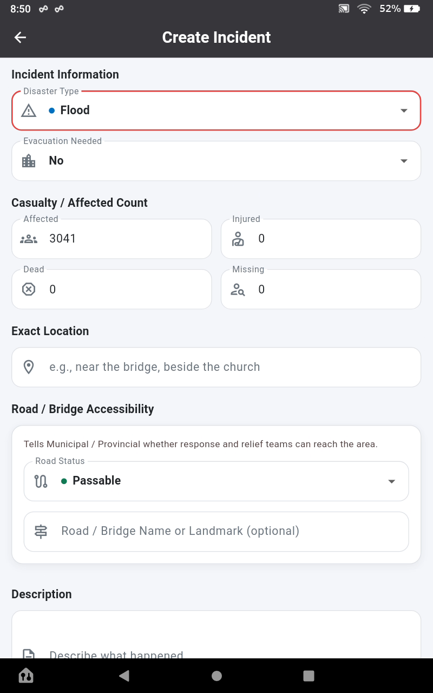 |

| App Evidence | App My Reports | App Offline Saved | App Offline Sync |
|:-:|:-:|:-:|:-:|
|  |  | 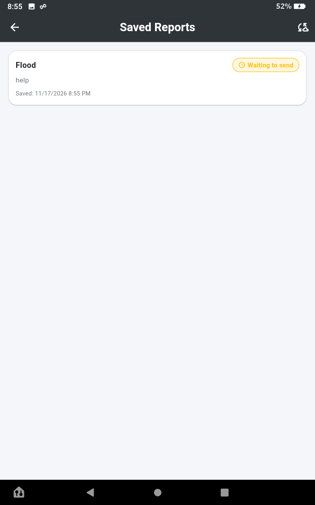 |  |

*Role-scoped field reporting from anywhere. GPS coordinate pinning and photo/video evidence capture for ground-truth disaster documentation. Offline report queuing with automatic background sync when connectivity is restored.*

---

### How to connect GitHub to InfinityFree

